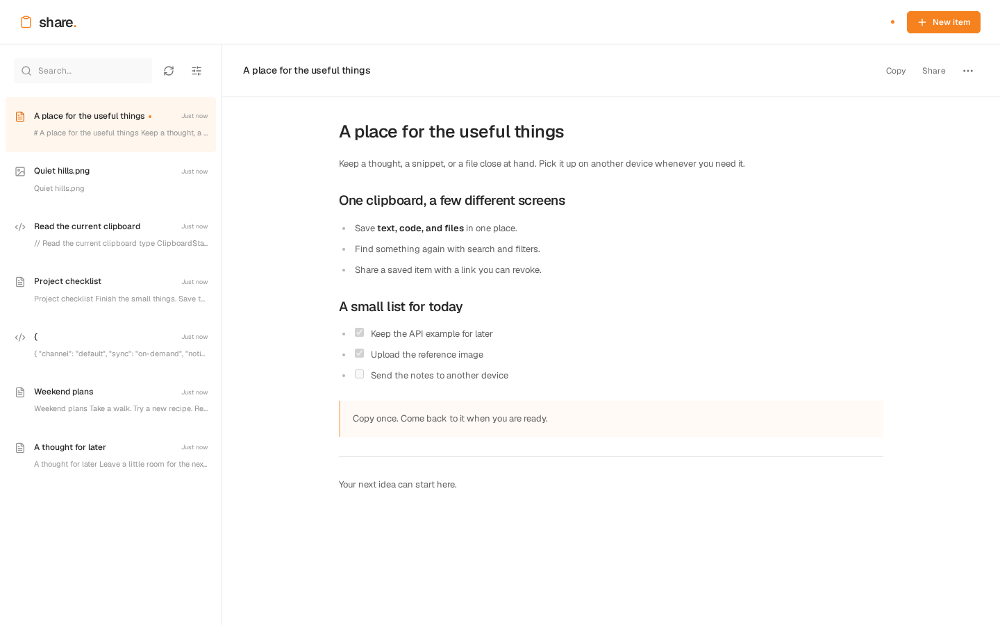
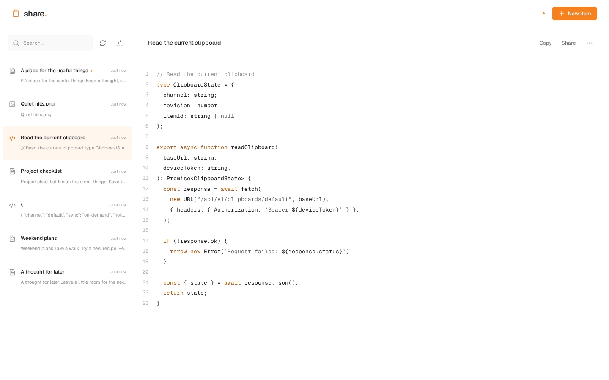
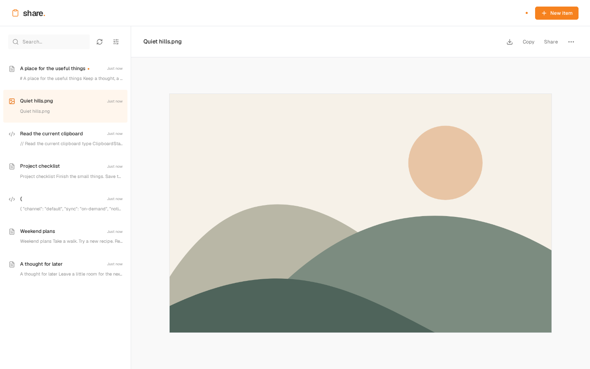
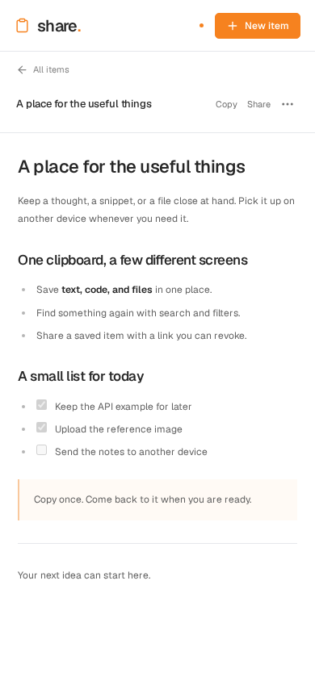

# Share Serverless

A self-hosted clipboard and file-sharing service for your own devices, built on Cloudflare Workers.

Save text, code, images, and files in one place. Find them in a minimal web console, share a fixed copy with a link, or use the API to move clipboard content between devices.



## Features

- **Text and files together.** Store multiple MIME representations and attachments in the same immutable item. Upload any file type to private R2 storage.
- **A focused console.** Browse a two-pane workspace, search text and filenames, filter by type or date, and use a layout that adapts to mobile screens.
- **Rich previews.** Read Markdown, inspect code with CodeMirror, preview images and supported media, and view sanitized HTML in a sandbox.
- **Shareable snapshots.** Create links to a fixed item, set an expiry, and revoke access. Later clipboard updates do not change an existing share.
- **Flexible clipboard sync.** Use HTTP for manual or on-demand updates, with optional WebSocket notifications for connected clients. Named channels, revision checks, and idempotent writes support custom clients.
- **Personal access control.** Sign in to the console with Cloudflare Access. Register separate, revocable device tokens for API clients.

## Screenshots

Screenshots use example content in an isolated local instance.

| Code preview | Image preview |
| --- | --- |
|  |  |

<details>
<summary>Mobile preview</summary>

<p></p>

</details>

## How it works

An **item** is immutable: its ID is the SHA-256 hash of its normalized content, including its MIME representations and file references. A **clipboard channel** is a mutable pointer to an item, with a server-ordered revision. Clients can pin an item ID while reading its formats, even if another device updates the channel.

| Component | Role |
| --- | --- |
| API Worker | Hono API for items, uploads, shares, devices, and clipboard channels |
| Console Worker | React + Vite interface; forwards API requests through a Service Binding |
| D1 | Item, file, device, and share metadata |
| R2 | Private file storage, accessed through the API |
| SQLite Durable Object | Clipboard pointers, ordered revisions, recent changes, and hibernating WebSocket connections |

The console is protected by Cloudflare Access. The API verifies signed Access JWTs or Bearer tokens; public share URLs grant access only to their snapshot and its files. Markdown disables raw HTML, HTML previews are sanitized and sandboxed, and the console Worker sets a Content Security Policy.

This is a personal, single-user service. The repository includes the backend and web console; native clipboard daemons and iOS Shortcuts are not included. Browsers read or write the system clipboard through user actions. Public share URLs currently return JSON and file download URLs, without a public HTML viewer. End-to-end encryption is not implemented.

## Local development

Use the latest Node.js 22.x, at least **22.22.2**, and **pnpm 12.19.0**.

```bash
pnpm install --frozen-lockfile
pnpm secrets:local
pnpm db:migrate:local
pnpm dev
```

- Console: <http://127.0.0.1:5173>
- API health check: <http://127.0.0.1:8787/api/health>

`pnpm secrets:local` creates ignored local credentials in `apps/api/.dev.vars` and `apps/console/.env.local`, preserving existing files. The Vite proxy adds the local API token on the server; it is not bundled into the browser application. Local development uses emulated Cloudflare resources.

## Deploy to Cloudflare

Connect the same Git repository to two **Workers Builds** projects. Deploy the API first, then the console. Enable R2 in your account before the first deployment.

| Setting | API | Console |
| --- | --- | --- |
| Worker name | `share-serverless-api` | `share-serverless-console` |
| Root directory | Repository root | `apps/console` |
| Build command | `pnpm cf:render && pnpm --filter @share/api typecheck` | `pnpm build` |
| Deploy command | `pnpm cf:deploy` | `pnpm exec wrangler deploy --env=""` |

Set **build variables** `NODE_VERSION=22` and `PNPM_VERSION=12.19.0` for both projects. The API build token needs Worker deployment, D1 edit, and R2 management permissions. Build variables are separate from Worker runtime configuration.

Configure these **runtime variables** in the API Worker's **Settings → Variables and Secrets**:

| Variable | Value |
| --- | --- |
| `PUBLIC_BASE_URL` | Optional canonical API HTTPS origin; otherwise discovered from Cloudflare domain bindings during deployment |
| `MAX_UPLOAD_BYTES` | Per-file limit in bytes; defaults to `104857600` (100 MiB) |
| `ACCESS_TEAM_DOMAIN` | Full Access team origin, such as `https://your-team.cloudflareaccess.com` |
| `ACCESS_AUD` | Audience tag of the Access application protecting the console |

The deployment script automatically selects the API Worker's custom domain, falling back to its `workers.dev` address on the first deployment. It stores the resulting share origin only in the temporary deployment configuration and the Worker runtime. If you bind a new domain, redeploy to update generated share URLs. With several API custom domains, select one using runtime `PUBLIC_BASE_URL`, or explicitly declare it in Wrangler.

Configure both Access values together before using the console. The renderer omits empty Access values; `keep_vars` preserves your Dashboard configuration on later builds. Explicit real values in [`apps/api/wrangler.jsonc`](apps/api/wrangler.jsonc) override the corresponding Dashboard values. `MAX_UPLOAD_BYTES` is declared in Wrangler by default. Deployment-specific domains, account IDs, and Access identifiers can stay out of the public repository.

Keep these two **runtime secrets** in the API Worker's Variables and Secrets settings:

| Secret | Value |
| --- | --- |
| `API_BEARER_TOKEN` | A random administrator token |
| `SHARE_SIGNING_KEY` | A base64-encoded 32-byte key for signing share links |

For a first build with no existing runtime secrets, generate two different values by running `openssl rand -base64 32` twice. Add them as **build secrets** named `RUNTIME_API_BEARER_TOKEN` and `RUNTIME_SHARE_SIGNING_KEY`. The deployment script installs them under their runtime names. After the first successful deployment, confirm the runtime secrets exist and remove both `RUNTIME_*` build secrets. Subsequent deployments preserve the installed secrets.

Resource names are already declared in Wrangler. The deployment script finds or creates D1 and applies migrations before deploying; Wrangler provisions R2 and the Durable Object. No production database ID is required in the repository. The console's API Service Binding is also declared.

Protect the **console hostname** with a Self-hosted Access application and an allow policy for your account. Use hostname-based Access to support WebSockets. Keep the API hostname reachable for device clients and public shares. The console needs no administrator token or separate runtime secrets.

See the [deployment guide](docs/DEPLOYMENT.md) for configuration ownership, token permissions, custom domains, and verification. Keep non-production branch builds disabled until separate resources are configured.

## Development checks

```bash
pnpm check        # Type checks, tests, builds, and deployment dry-runs
pnpm test:deploy  # Deployment orchestration tests with simulated CLI commands
pnpm cf:typegen   # Regenerate types after changing Wrangler bindings

# Browser tests against isolated local services and storage
pnpm --filter @share/console exec playwright install chromium
pnpm --filter @share/console test:e2e
```

These checks do not deploy to Cloudflare or modify production resources.

## Project layout

```text
apps/api/       API Worker, Durable Object, D1 migrations, and integration tests
apps/console/   Web console, forwarding Worker, and browser tests
shared/         Shared protocol types
scripts/        Local credentials and Cloudflare deployment tooling
docs/           API, sync protocol, console, and deployment documentation
```

## Documentation

- [API reference and examples](docs/API.md)
- [Clipboard sync protocol and device integration](docs/CLIPBOARD.md)
- [Console behavior and preview security](docs/CONSOLE.md)
- [Deployment guide](docs/DEPLOYMENT.md)
