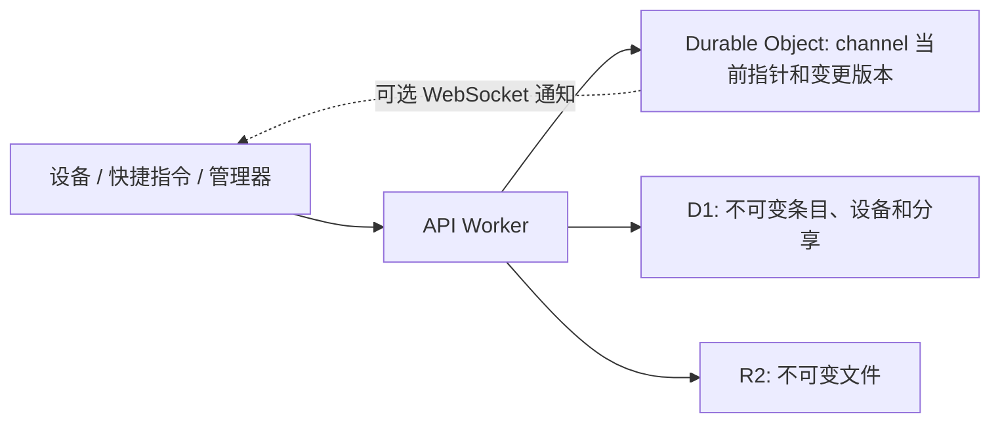

# 剪贴板同步与设备适配

## 数据模型



条目与当前指针分开：

- `itemId` 标识固定的内容及全部 MIME 表示，创建后不修改。相同规范化内容复用同一个 ID。
- `channel` 是命名剪贴板，例如 `default`、`work`。个人空间最多 100 个 channel。
- `revision` 是该 channel 的服务端递增版本，与设备时间无关；重新指向以前的条目也是一次新版本。
- 同一次粘贴先确定 `itemId`，后续查询格式和读取数据都使用这个 ID。其他设备更新当前指针不会改变这次粘贴的数据。
- 删除文件会让对应字节不可用；不可变不表示永久保留，条目的元数据不会因此被重写。

## 受限设备：HTTP 手动收发

iOS 快捷指令可把“获取剪贴板 → 请求 API”封装为上传操作，用 `POST /api/v1/clipboards/default` 一次写入。每次用户发起的新操作生成新 mutationId；请求重试复用它。

下载操作是“请求 `/api/v1/clipboards/default/text` → 拷贝到剪贴板”。有二进制或多格式需求时先读指针、再根据 `itemId` 获取固定条目与文件，选择本机支持的表示。纯文本读取返回 `X-Clipboard-Item-Id`，可记录本次读取的条目身份。

这符合 Apple Shortcuts 提供的 Get Clipboard 和 Copy to Clipboard 操作，不依赖 iOS 常驻监听、后台剪贴板读取或持久连接。[Apple 官方指南](https://support.apple.com/en-gb/guide/shortcuts/apd081d9d61f/9.0/ios/26)

## 桌面管理器：按需读取

Wayland 数据源在接收方请求具体格式时收到 `send(mime_type, fd)` 事件，再通过给定文件描述符提供数据。这允许你自己的剪贴板管理器实现延迟网络读取。[Wayland 官方协议说明](https://wayland.freedesktop.org/docs/book/Protocol.html)

建议客户端流程：

1. 本地复制发生时读取所需格式，上传文件，创建固定条目，提交指针更新。
2. 为本次本地 selection 保存固定条目 ID 和它支持的 MIME 类型。
3. 接到数据请求后，通过普通 HTTP 检查云端指针；有变化时为后续 selection 发布新条目的格式。
4. 本次已经开始的传输继续使用协商时固定的条目 ID 和 MIME，不在一个传输过程中切换条目。
5. 多个 MIME 数据请求属于同一份 selection 时复用同一条目。短时间并发请求合并，网络超时使用本地已缓存的对应条目，或明确失败。

`send` 是数据请求事件，不是全局 Ctrl+V 事件。应用可以预读或缓存剪贴板；其他程序复制也会改变 selection 所有者。即使自行实现管理器，也需要 compositor 允许相应后台读取、监控与接管协议。部署在具体 Linux 桌面时，应检查 `ext-data-control-v1` / `zwlr_data_control_manager_v1` 或该桌面的专用能力。

因此，“每次原生 Ctrl+V 必定先查云端，并在本次粘贴中改用任何新格式”不能仅靠标准 Wayland 数据源回调跨桌面保证。可实现的按需数据提供、主动发布新 selection 和 compositor 快捷键集成需要在客户端区分。普通 `wl-copy` 读取一次 stdin 并提供内容，不能把它直接当作任意按需 HTTP 回调；自行实现数据源才有这个控制点。[wl-clipboard 项目](https://github.com/bugaevc/wl-clipboard)

## 可选 WebSocket

```text
wss://<api>/api/v1/clipboards/default/events?after=<最后已处理的 revision>
Authorization: Bearer <device-token>
```

连接使用普通 API 的认证方式。原生 daemon 可发送 Authorization header；后续同源 Console 可通过 Access 会话与 Service Binding 转发认证。URL 不接受管理员或设备令牌查询参数。

服务端消息只包含指针元数据，不包含剪贴板正文：

```json
{
	"type": "clipboard.changed",
	"channel": "default",
	"revision": 12,
	"itemId": "不可变条目 ID",
	"sourceDeviceId": "设备 UUID",
	"updatedAt": "2026-11-12T00:00:00.000Z",
	"mutationId": "写入时的幂等键"
}
```

- 带有效 `after` 时，先按序补发已保留的变更，再发 `sync.ready`，其 revision 表示握手时的当前版本。
- 不带 `after` 或游标过旧时，先发 `sync.reset`，其中 `state` 是完整当前指针，再发 `sync.ready`。客户端应将旧游标替换为该状态，并按需要取条目。
- 游标领先服务端时返回 HTTP 409，不建立连接。
- 同一对象内串行接受订阅和更新，避免“读快照后到开始订阅前”的漏消息窗口。
- 客户端发送文本 `ping`，服务端自动回复 `pong`；正文写入统一走支持幂等和版本检查的 HTTP 接口。
- 使用 Hibernation API，空闲时可休眠；最多同时 64 个连接。连接最长 24 小时，Access 会话还受 JWT 到期时间约束。到期关闭码 4001，设备撤销关闭码 4003。
- 断线后指数退避重连，带上最后已处理的 revision。WebSocket 通知是可恢复的提醒，不承诺端到端恰好一次；客户端忽略已处理的旧版本。

这是可选能力，关闭或不使用 WebSocket 不影响 HTTP 按需同步。Cloudflare 支持休眠时保留 WebSocket 连接。[官方文档](https://developers.cloudflare.com/durable-objects/best-practices/websockets/)

## 防回环与离线冲突

管理器维护：最后已处理版本、本机最新复制意图、待上传条目，以及最近由远端写入本机的条目 ID / 内容摘要。

本地剪贴板发生变化时，如果与刚刚应用的远端条目一致，不再次上传。`sourceDeviceId` 可用于识别自己的更新，但不能替代内容比对，因为操作系统可能转换格式、换行或只保留部分 MIME 表示。

常驻管理器写指针时带 `baseRevision`。409 时保留本地不可变条目，获取新指针并按客户端策略决定是否让用户选择；不要自动换一个更高 baseRevision 后覆盖云端。

手动“上传当前剪贴板”可以省略 baseRevision，表达用户希望把本地内容设为当前的意图。客户端时钟不用于决定胜负，排序由 Durable Object 提交版本确定。幂等重试必须复用原 mutationId 和完整参数，不能重新生成 ID。
